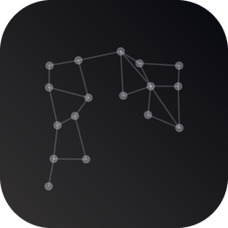
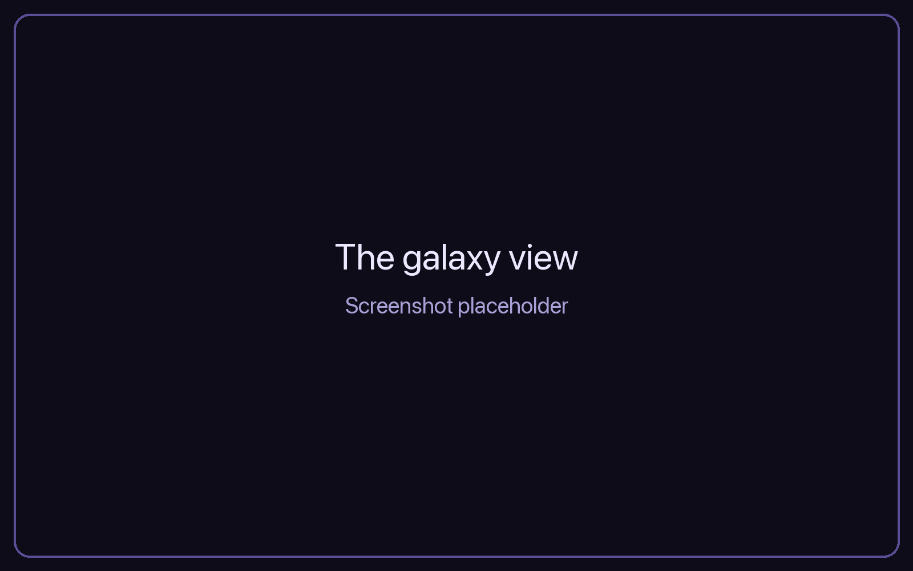
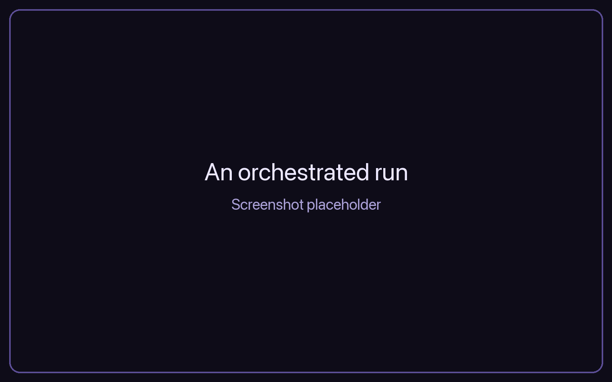
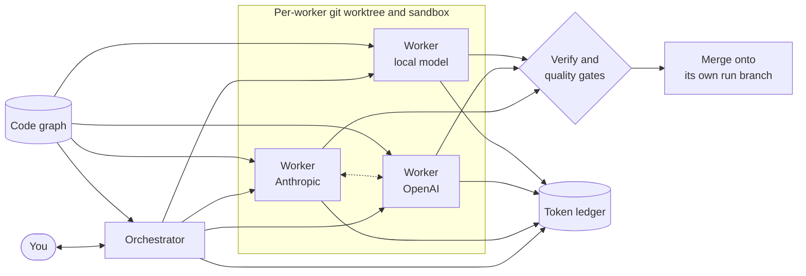

<div align="center">



# kGraf

**Direct a team of AI coding agents from different providers, and watch the work happen on a live map of your code.**

[](LICENSE)
[](https://www.rust-lang.org)
[](#install)
[](ROADMAP.md)

[Quick start](#quick-start) · [Features](#features) · [How it works](#how-it-works) · [Usage guide](docs/USAGE.md) · [Architecture](ARCHITECTURE.md) · [Roadmap](ROADMAP.md)

</div>

<!-- Placeholder: replace .github/assets/screenshot-galaxy.png with a capture of the galaxy view. -->
<p align="center">
  
</p>

## What it is

You talk to one agent, the orchestrator. It plans the work with you, then spawns and
retires as many worker agents as the plan needs. It splits the job into parts and picks a
provider for each part, or uses the providers you pinned. Workers from different vendors
run at the same time on different parts of the same problem, and they can talk to each
other directly.

All of it is drawn on a live graph of the software being built. Every node is a code
element. Every agent shows the code it touches and the agents it coordinates with.

kGraf is a native desktop app and a command line. It runs on your machine, with your
own provider keys. There is no account, no hosted service and no telemetry.

## Features

| | |
|---|---|
| **One orchestrator, many workers** | Decomposes an instruction into contracts, dispatches workers across providers in parallel, verifies each attempt, runs quality gates, and merges verified work onto its own branch. Your checked-out branch never moves. |
| **Multi-provider** | Anthropic, OpenAI, Moonshot (Kimi), DeepSeek, z.ai, Qwen, xAI, Google (Gemini and Vertex AI), AWS Bedrock, Azure OpenAI, Llama hosts, and local Ollama or llama.cpp, plus embedding, rerank and typed-decision models. `kgraf providers` shows what is verified for each route, and [docs/MODEL-SUPPORT.md](docs/MODEL-SUPPORT.md) lists which routes and model kinds have run against the live service and which are built but untested. |
| **A code knowledge graph** | Indexes Rust, Python, TypeScript, JavaScript, Go, Java, C, C++, Ruby, C#, PHP and Markdown. Agent context is assembled from graph slices, not whole-file reads. |
| **The galaxy** | A GPU-rendered map of the project, with a stated CPU mode when there is no GPU. Work, agents and changes show on it live. |
| **Isolated workers** | Each worker writes only in its own git worktree, inside a per-platform sandbox. Work merges back one worker at a time. |
| **Every token accounted** | Every model call goes through a hash-chained ledger. `kgraf spend` totals it, and `kgraf ledger verify` walks the chain. |
| **Reads your roadmap** | Turns `ROADMAP.md`, `TODO.md` and similar files into work nodes, and flags where the document and the code disagree. |
| **Uses your existing setup** | Reads the `CLAUDE.md`, `AGENTS.md`, `GEMINI.md` and `SKILL.md` files your other coding agents already use. Connects to MCP servers, local or hosted. |
| **Scheduled runs** | Cron or one-shot schedules attached to work nodes. The desktop app fires them from the tray. |
| **Secrets stay out of transcripts** | Transcripts are scrubbed with gitleaks rules plus a registry of your own secrets. |

<!-- Placeholder: replace .github/assets/screenshot-run.png with a capture of an orchestrated run. -->
<p align="center">
  
</p>

## Quick start

kGraf builds from source. You need [Rust](https://rustup.rs) 1.95 or later and git.

```bash
git clone https://github.com/Marceux-Croix/kGraf.git
cd kGraf
cargo install --path crates/kgraf-cli
cargo install --path crates/kgraf-shell
```

This installs two programs: `kgraf`, the command line, and `kgraf-app`, the desktop window.

**Index a repository and explore its graph:**

```bash
cd /path/to/your/repo
kgraf index
kgraf symbol main
kgraf slice main --budget 1500
kgraf query 'kind=function -calls-> name=main'
```

**Open it in the desktop app:**

```bash
kgraf-app --project /path/to/your/repo
```

**Run a team of agents.** Set each provider key in your shell (kGraf never reads keys from
a file). Workers build with the network off, so let kGraf fetch the project's dependencies
when a run needs them (once per project; or run `cargo fetch` yourself). Then give the
orchestrator an instruction:

```bash
export KGRAF_KIMI_API_KEY=...
export KGRAF_OPENAI_API_KEY=...
kgraf deps allow
kgraf orchestrate --route kimi:<model-id> --route openai:<model-id> \
  --instruction task.txt --prices prices.json
```

A model missing from `prices.json` still runs; its spend is reported as unpriced, never as
zero. `kgraf orchestrate` exits non-zero unless the run completed.

The [usage guide](docs/USAGE.md) covers every command, flag and window in detail.

## How it works



1. **Index.** `kgraf index` parses the repository into a graph of code elements, calls,
   co-change history and roadmap items. Every run also refreshes the graph before it starts.
2. **Plan.** The orchestrator agrees the plan with you, then splits it into contracts.
3. **Dispatch.** Workers run in parallel, each in its own worktree and sandbox, each fed
   from graph slices.
4. **Verify.** Each attempt runs your test command and quality gates. Only verified work
   merges, onto a branch of its own.
5. **Account.** Every call, from every agent, lands in the ledger with its tokens and cost.

One Rust process does everything except draw. The desktop shell is native Rust
(egui and wgpu), with no web view. [ARCHITECTURE.md](ARCHITECTURE.md) has the full design.

## Install

Prebuilt packages are not published yet. Local packaging scripts build them from this tree:

| Platform | Script | Output |
|---|---|---|
| macOS | `scripts/package-macos.sh` | Universal `kGraf.app` and `.dmg` |
| Linux | `scripts/package-linux.sh` | Tarball and `.deb` |
| Windows | `scripts/package-windows.sh` | x64 `.msi` and `.zip` |

The packages are not yet signed with a developer certificate, so expect Gatekeeper and
SmartScreen warnings. `scripts/release-all.sh` builds all three from one git tag.

## Project status

kGraf is **pre-release** software. The command line and the desktop app work today, and
orchestrated runs across providers have run live end to end. Some parts are still open,
such as signed installers and a few desktop workflows. [ROADMAP.md](ROADMAP.md) lists what
each phase has and what it still lacks.

### What it costs

kGraf makes no claim to save tokens. A team of agents costs more than one competent coding
agent on the same work: about 2.6x the tokens by the project's cost model. The case for
kGraf is control, visibility, and the freedom to give each part of a job to the model that
suits it. Every token is on the ledger, so you always see where the money went.

## Privacy

- Local only and single-user. No hosted mode, no account, no telemetry.
- Network traffic goes only to the model providers and MCP servers you configure. Those
  calls carry code from your repository. For a project where you allow it (`kgraf deps
  allow`), kGraf also downloads the project's dependencies from crates.io; it never does so
  unasked.
- Provider keys come from your shell environment, never from a file.
- A small local diagnostics file records usage counts and errors. It is never sent
  anywhere. `kgraf diag show` reads it.

## Repository layout

| Path | Contents |
|---|---|
| [`crates/`](crates) | The Rust workspace: graph, providers, runtime, orchestrator, sandbox, galaxy renderer, desktop shell and CLI |
| [`docs/`](docs) | Usage guide, decision records, error glossary |
| [`third_party/`](third_party) | Code taken from permissively licensed projects, each with its `UPSTREAM` record |
| [`scripts/`](scripts), [`packaging/`](packaging) | Installers and release tooling |

## Documentation

- [Usage guide](docs/USAGE.md): every command and the desktop app
- [ARCHITECTURE.md](ARCHITECTURE.md): system design
- [ROADMAP.md](ROADMAP.md): phases and status
- [docs/decisions/](docs/decisions): architecture decision records and evidence
- [docs/ERRORS.md](docs/ERRORS.md): the `KG-nnnn` error glossary

## Contributing

Bug reports and ideas are welcome. Read [CONTRIBUTING.md](CONTRIBUTING.md) before you open
a pull request, and [SECURITY.md](SECURITY.md) to report a vulnerability.

## Acknowledgments

kGraf stands on permissively licensed open source. It reuses code from projects that
include codex-rs, container-use, codebase-memory-mcp, aider, Graphiti, litellm, gitleaks,
rerun and `rmcp`, and takes design ideas from Haystack, CowAgent and others. Each copy's origin is in
`third_party/<name>/UPSTREAM`, and every dependency's license is in
[THIRD_PARTY_NOTICES.md](THIRD_PARTY_NOTICES.md).

## License

Licensed under the [Apache License, Version 2.0](LICENSE).
